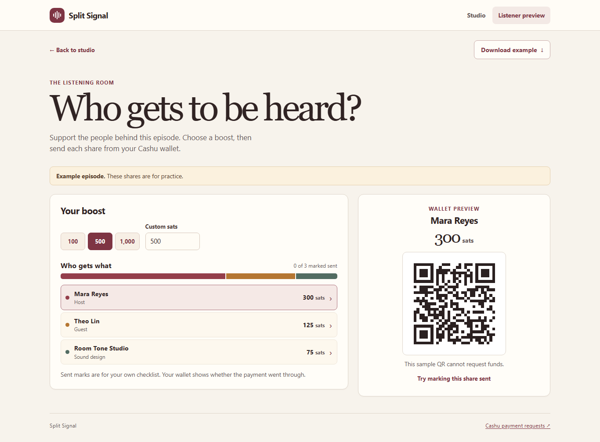

# Split Signal

Make a podcast support page that sends Cashu boosts to the host, guest, editor or anyone else who made the episode. The listener picks a total in sats and gets a separate wallet request for each share. Split Signal routes no money through a platform wallet.



## Try the example

Download and open `docs/index.html`, or open `dist/index.html` after building. The studio opens with a fictional episode and a 60 / 25 / 15 split. Choose **Listener preview**, select a boost and choose a recipient. A 500-sat boost allocates 300, 125 and 75 sats. You can mark shares sent to try the checklist and download the example as a stand-alone HTML page. Example addresses cannot receive funds. The example QR encodes a text label.

## Publish an episode

1. Choose **Start my own episode**. Add contributors and their split weights. Optionally import the weights and names from a local Podcasting 2.0 RSS file. The tool reads channel and episode-level splits and leaves out fee recipients. It does not copy the feed's Lightning addresses or import time-based splits.
2. Ask each contributor for a reusable, amountless Cashu request with Nostr or HTTPS delivery. Enter it on their row. The studio accepts `creqA`, `creqB` and BIP-321 links with a `creq` parameter. Fixed-amount and single-use requests need a new request from the recipient.
3. Preview, verify each destination with its recipient and download the support page. Put the HTML file beside the show notes or on your usual static host. Anyone who can open the page can read its receiving requests, so use requests intended for publication.
4. Listeners copy, scan or open each request in a compatible Cashu wallet. The wallet handles sending and fees. Sent marks are local checklist items. Recipients confirm delivery in their own wallet.

## Build and test

Use Node.js 22 and npm.

```sh
npm ci
npm test
npm run build
```

Open `dist/index.html` directly. The HTML contains the app and works offline. Split Signal has no server, analytics or wallet connection. Its app code makes no payment requests to a mint, relay or delivery endpoint. Using **Open wallet** passes a request to the device's Bitcoin URI handler. If the handler cannot open Cashu, use **Copy request**.

## How requests are built

Each share starts with a floor in whole sats. The remaining sats go to the largest fractional remainders, with ties in recipient order. Share amounts sum exactly to the listener's total. The tool leaves a zero-sat share unpaid. When writing a request it preserves the existing routing, ID, mint restrictions and other fields, and sets the amount and the sat unit. Nostr and HTTPS delivery depend on wallet compatibility and the recipient's setup.

This project was built for the 2026 Nut November Value4Value track. All example people and destinations are fictional.

[Cashu NUT-18](https://cashubtc.github.io/nuts/18/) · [Cashu NUT-26](https://cashubtc.github.io/nuts/26/) · [Podcasting 2.0 value tag](https://podcasting2.org/docs/podcast-namespace/tags/value)
